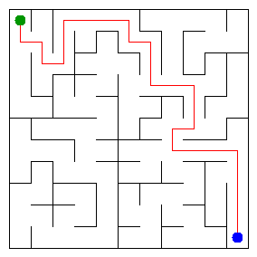

# Assignment 3. Maze Escape

- **Student ID:** 250304
- **Name:** Dariya Zhagufarova
- **Group:** SE-2532
- **Maze size:** 11 x 11 (121 cells, 220 inner walls)
- **Language:** Java 17; standard-library collections only, no graph or DSU libraries.

## Build and run

Run from the repository root with a JDK 17 or newer:

```sh
javac -d out src/*.java
java -cp out Main
```

Personal inputs are included. To reproduce them:

```sh
java tools/MakeVariant.java 250304 data
```

Open `output/maze.html` in a browser to explore the maze, display the escape path and zones, and walk with the arrow keys. Main also regenerates the image below. Original instructions: [START_HERE.md](START_HERE.md); task: [Assignment3.pdf](docs/Assignment3.pdf).

## Program output

Actual output for the personal inputs:

```text
Broken: 120
Kept: 100
Last broken wall: 161
MST cost: 32192
Heaviest broken wall: 729
Path length: 26
DFS visited: 48
Dead ends: 33
Zones: 8
Largest zone: 23
Is DAG: 0
Flow stages: 5
Fastest route cost: 7
```



## Questions

### Mission 0. What do find and union do, and what makes them fast?

`find(x)` returns the representative of the group containing cell x. `union(a,b)` joins two different groups and returns true, or returns false if they already have the same representative. Union by size puts the smaller tree under the larger one, and path compression makes every node visited by find point directly to its root; together they give amortized O(alpha(n)) operations.

### Mission 1. Why is Broken R*C - 1, and Kept (R-1)*(C-1)?

Initially there are R*C separate components, and each broken wall reduces their count by exactly one without creating a cycle. The complete rectangular grid is connected, so exactly R*C - 1 walls must be broken to leave one component. There are R*(C-1) + C*(R-1) inner walls in total; subtracting R*C - 1 leaves R*C - R - C + 1 = (R-1)*(C-1).

### Mission 2. MST costs from Kruskal and Prim, and why they are equal

Both algorithms give **32192** on the personal input; the heaviest chosen wall costs **729**. Kruskal considers walls by increasing cost and rejects cycles, while Prim repeatedly adds the cheapest edge crossing from its tree to an unvisited cell. Both choices satisfy the MST cut property, so both produce a minimum spanning tree; distinct wall costs also make that tree unique.

### Mission 3. Why exactly one path? How is stack overflow avoided?

The Mission 1 maze is connected and has no cycles, so it is a tree: two different simple paths between the same cells would create a cycle. DFS uses explicit arrays for the current path and each frame's next direction, rather than recursive calls. It marks one new cell at a time in up, right, down, left order and stops as soon as the exit is marked, so the visited count matches the specified recursive DFS behavior.

### Mission 4. Why use the reversed graph in the second pass? Why does Zones = cells mean a DAG?

The first pass records finishing order in the original graph; in decreasing finishing order, the next unassigned component is a source among the remaining components. Traversing reversed edges cannot escape from it into another unassigned component, but still reaches all vertices within that SCC; the original outgoing edges could instead lead into later zones. A directed cycle of length at least two puts its cells in one SCC, and a multi-cell SCC contains a cycle, so every SCC is a singleton exactly when there are no cycles here, because the input forbids self-loops.

### Mission 5. Why is zone-number order enough? What does the pass cost?

Kosaraju numbers zones in topological order, so every edge between different zones goes from a smaller number to a larger one. When a zone is processed, all its possible predecessors have already been processed: relax the shortest distance from the start and update the longest chain length, initializing every zone's chain length to one because the longest chain can start anywhere. With z zones and e distinct inter-zone edges, the pass takes O(z+e) time and O(z) state; building the maps takes expected O(n+m) time, including initialization, and O(z+e) space, retaining only the cheapest parallel slide.

## AI use

**Tool: OpenAI ChatGPT / Codex.** AI was used to draft the implementations in `DisjointSet`, `Maze`, `Escape` and `Zones`, extend the DSU checks, write independent algorithm tests, draft this report and a Russian study guide, run the supplied checks and benchmarks, and prepare Git commits and the repository. The code and explanations are AI-assisted drafts, not a claim of unaided student authorship. They need personal review, adaptation and understanding before submission in accordance with the course rules; automated tests do not replace the student's defense.

The instructor-provided starter is the source of the unchanged `Main`, `Input`, `Graphs`, `Render`, `Generator`, `Bench`, tools, examples and assignment documents. No external solution code or graph libraries were used. The Git history records actual implementation steps during the assisted session; it is not a claim that the work was performed independently over multiple days.

## Timing (Mission 7)

Measured with the **unchanged** `java -cp out Bench`, five runs per size, on Apple M5 (arm64), OpenJDK 17.0.20.1. Each entry lists the five rounded millisecond measurements and the average printed by Bench (calculated from unrounded measurements).

| Maze | Kruskal, ms: five runs; average | Prim, ms: five runs; average |
|---|---|---|
| 100 x 100 | 10, 5, 4, 5, 6; **6** | 11, 3, 4, 4, 3; **5** |
| 300 x 300 | 35, 64, 66, 35, 27; **46** | 38, 38, 38, 38, 40; **38** |
| 1000 x 1000 | 450, 448, 463, 447, 433; **448** | 784, 735, 777, 739, 838; **775** |

Both times increase as the number of cells and walls grows; for a grid, m is proportional to n, so both implementations have O(n log n) time bounds. Kruskal is faster on the largest measured grid, while Prim is slightly faster on the two smaller ones, reflecting different constants and queue/sort costs rather than a different asymptotic bound. JVM warmup, garbage collection and normal timing noise affect these short runs, so the measurements illustrate scaling without proving an exact growth ratio.

Raw measurements: [output/benchmark.txt](output/benchmark.txt).

## Complexity

n is the number of cells; m is the number of walls or slides. z is the number of zones and e the number of distinct edges between zones. Space includes auxiliary graph structures and output arrays, but not the already supplied input.

| Algorithm | Time | Space | Assumptions |
|---|---|---|---|
| DSU find and union | O(alpha(n)) amortized per operation; O(n) initialization | O(n) total, O(1) extra per operation | Union by size and iterative full path compression |
| Input-order maze construction | O(n + m alpha(n)) | O(n) | Connected rectangular grid |
| Kruskal | O(n + m log m + m alpha(n)) | O(n+m) | Sorts boxed wall indices; connected input |
| Prim | O(n + m log(m+1)) | O(n+m) | Lazy edge priority queue, incident-wall adjacency; grid m=O(n) |
| DFS escape | O(n+m), O(n) for a tree maze | O(n+m) | Grid degree at most four; explicit frames, all dead ends counted |
| Kosaraju | O(n+m) | O(n+m) | Two iterative DFS passes and both adjacency lists |
| Route in zone graph | Expected O(n+m) construction, O(z+e) DP pass | O(z+e) | HashMap minimum-edge deduplication; topological zone IDs |

## Validation

```sh
java tools/Check.java
java -Xss256k -Xmx1g -cp out AlgorithmTest
java -cp out Main
```

- The supplied checker passes all 13 output lines for **tiny**, **small** and **dag**, and all DSU checks.
- `AlgorithmTest` compares MST results to exhaustive spanning-tree enumeration on 100 small grids and checks DFS against a small recursive reference.
- On 200 seeded random directed graphs, transitive closure independently checks SCC membership, Floyd-Warshall checks zone-route costs, and exhaustive DAG paths check flow stages.
- Additional cases cover a single cell, parallel slides, free movement inside a zone, a longest chain outside the start component, a million-cell corridor, a million-vertex slide DAG and escape on a 1000 x 1000 grid, with a 256 KB JVM thread stack.
- Run Main last: the supplied checker renders example mazes, so Main restores the personal image and HTML.

## Before submission

The source, personal inputs, maze image, interactive HTML, actual output and timing results are included. Read and adapt the AI-assisted solution, review the [Russian study guide](docs/DEFENSE_RU.md), and make sure you can explain the implementation. Submit the public repository link in Moodle yourself before the course deadline; creating this repository does not submit it in Moodle.
